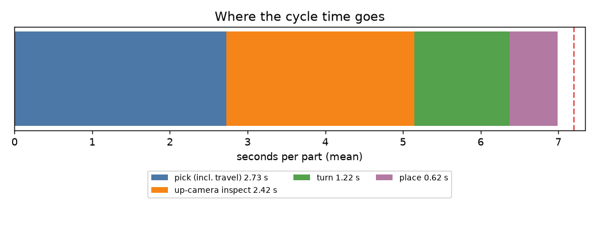

# Speed Settings

The settings that took the machine from about 46 s per part (first run, 11-14) to about 7 s
(~511 parts per hour, 11-18). All are in `Software/pnpvision/config.toml` unless noted.

| Setting | Value | What it does | Notes |
|---|---|---|---|
| streamed moves | on (in code) | sends a whole pick-inspect-place sequence to Klipper at once instead of waiting after every move | the biggest single gain |
| `[run] xy_feedrate` | 24000 mm/min | X/Y travel during jobs (400 mm/s) | printer.cfg allows 600 mm/s |
| `[run] accel` | 5000 mm/s² | acceleration during jobs, restored afterwards | printer.cfg max 7500 |
| `[run] z_feeds` | approach/lift/inspect 3000, touch/release_lift 1500 mm/min | Z speeds per phase | Z is capped at 50 mm/s in printer.cfg |
| `[run] vac_ms` / `release_ms` | 150 / 200 ms | wait for vacuum before lifting / for release before lifting | lower risks dropping parts |
| `[run] verify` | false | skip the empty-nozzle check after placing | saves ~8 s per part; board-check covers it afterwards |
| `[lighting.up] settle_s` | 0.10 s | wait after the ring light before the inspection photo | |
| rotation (`printer.cfg [manual_stepper stepper_r]`) | 360 °/s, 3000 °/s² | nozzle turn speed | |
| feeder stroke (`pnp_feeders.cfg`) | 400 ms out / 400 ms back | | faster or ramped strokes bounced parts out |

## Where the time goes now

Pick including travel ~2.7 s, up-camera inspection ~2.4 s, turn ~1.2 s, place ~0.6 s. Next
candidates: overlapping the feeder stroke with motion, and pre-turning the nozzle on the way to the
up camera.

!!! warning "Change one thing at a time"
    After each change run the 23-part test job and `check-board`: a faster setting that costs
    picks or accuracy is not a gain. If Z starts to skip (clicks, wrong heights), go back:
    [Troubleshooting](../help/troubleshooting.md).
