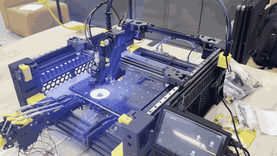

# Running Jobs

Everyday use, once the machine is built, set up and calibrated. A normal day needs only the
touchscreen.

{ .oshe-gif }

*One part in real time (about 7 s): feed, pick, check over the up camera, turn, place.*

1. [Daily startup](startup.md): power on, Vision home, lights.
2. [Make a job](make-a-job.md): KiCad board -> pnpslice -> job file.
3. [Load jobs from SD / USB](load-jobs.md): get the job onto the machine without a network.
4. [Run a job](run-a-job.md): board on the plate, Start, watch.
5. [After the job](after-the-job.md): check the board, read the report.
6. [Shutdown](shutdown.md).

!!! tip "Your first job"
    Run the included **Test PCB-top-0603** job (23 x 0603 resistors from feeder F1) with
    **Dry run** on first: the camera visits every placement and nothing is picked. Then run it for
    real.
