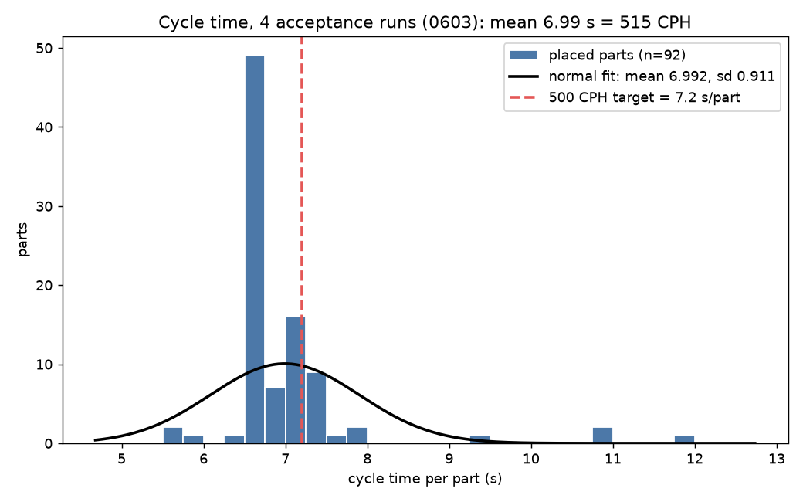
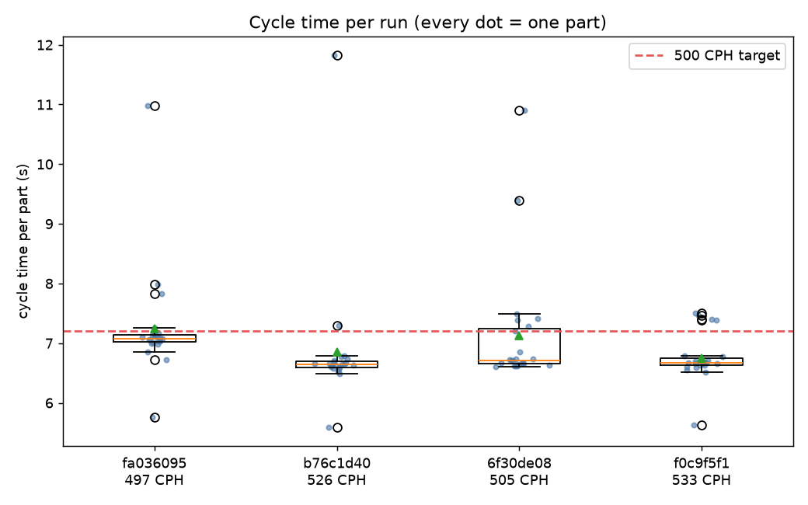
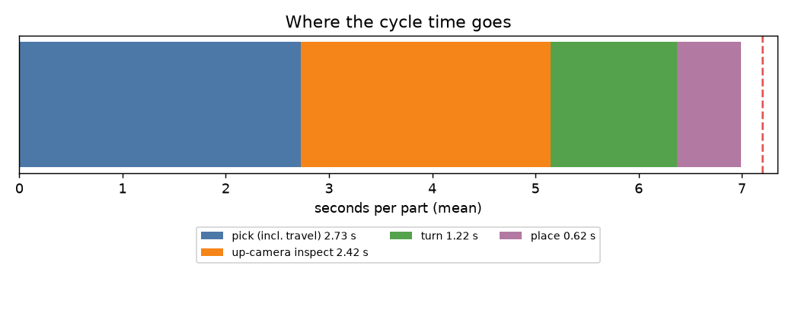
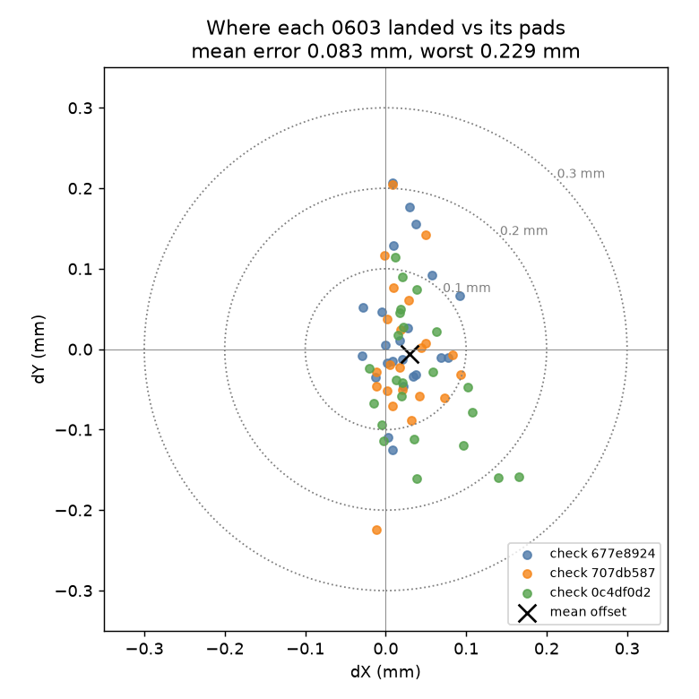
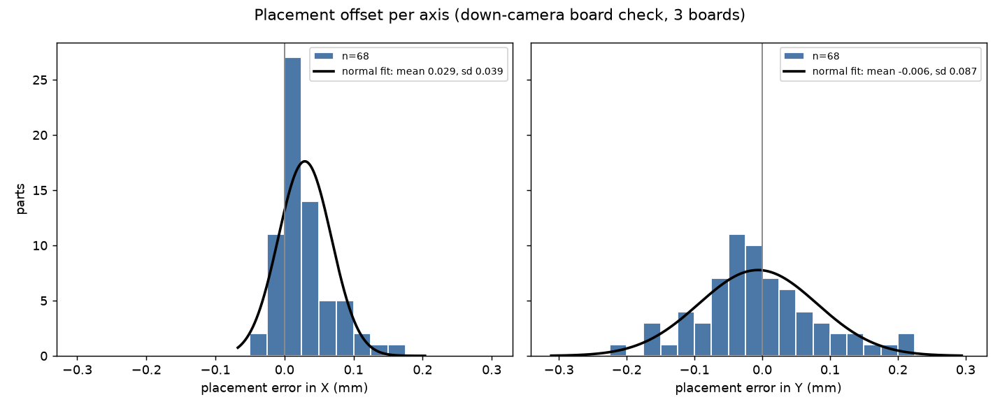
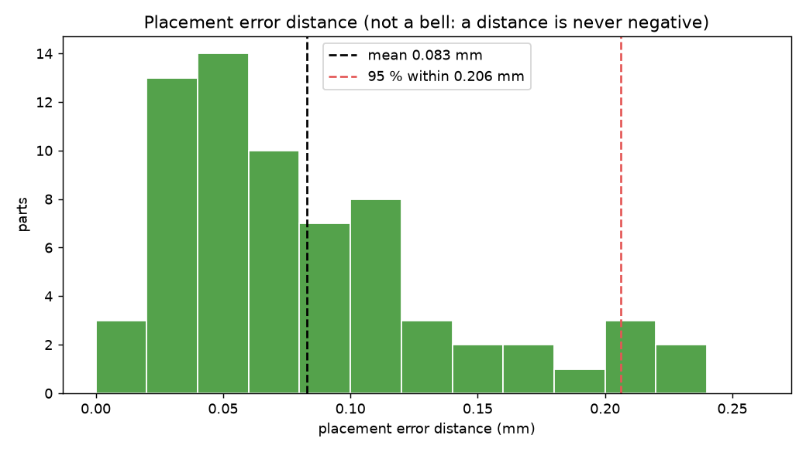
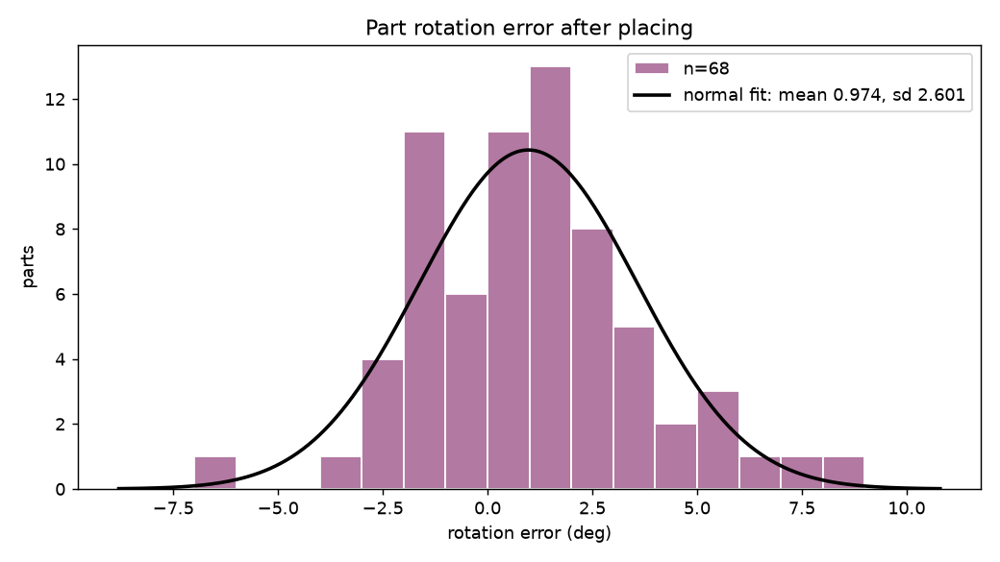

# Results

Final acceptance runs, 2026-11-18. Procedure and conditions: [Acceptance Tests](acceptance.md).

## Summary

| # | Requirement | Target | Result | |
|---|---|---|---|---|
| 1 | Touchscreen-only operation | yes | job loaded from SD/USB and run from the touchscreen | pass |
| 2 | Vision pass/fail correct | ≥ 95 % | **193 / 193** up-camera and **138 / 138** board-check decisions correct | pass |
| 3 | Pick success | ≥ 95 % | **92 / 94 = 97.9 %** | pass |
| 4 | Feeder runs | complete | 4 runs complete; 2 empty picks, both retried | pass |
| 5 | Speed | ≥ 500 CPH | **491 / 519 / 499 / 527** (average ~511) | pass on average |
| 6 | Placement error | report | mean **0.075 - 0.094 mm** per board, worst **0.229 mm** | - |
| 7 | Continuous operation | 4 runs | 92 parts back to back, no repair or recalibration | pass |

## Runs

| Run | Placed | Picks | s/part | CPH | Rejects | Board check | Mean error | Worst |
|---|---|---|---|---|---|---|---|---|
| fa036095 (11-17) | 23 | 23/24 | 7.3 | 491 | 0 | - | - | - |
| b76c1d40 | 23 | 23/23 | 6.9 | 519 | 1 | 677e8924 | 0.075 mm (23 parts) | 0.207 mm |
| 6f30de08 | 23 | 23/24 | 7.2 | 499 | 1 (upside down) | 707db587 | 0.080 mm (22 parts) | 0.225 mm |
| f0c9f5f1 | 23 | 23/23 | 6.8 | 527 | 0 | 0c4df0d2 | 0.094 mm (23 parts) | 0.229 mm |

Each board check also looked at the 23 empty 0805 footprints on the same board: all correctly
reported **MISSING** (46 decisions per board).

## Cycle time

92 parts, mean 6.99 s per part (515 CPH from the part times alone; the per-run figures above also
include each job's start). Most parts take 6.6 s or 7.2 s; the few at 9 - 12 s are retries.

## Placement accuracy

68 measured placements over three boards. The mean offset is +0.029 mm in X and -0.006 mm in Y:
there is almost no systematic error left; the spread is random.

## Earlier results

| Date | Test | Result |
|---|---|---|
| 11-11 | 0805 place tests (camera-centred) | parts within 0.03 - 0.14 mm, angle within ±0.9° at 0°/90° |
| 11-14 | first full job from the touchscreen (0805, no feeders) | 48 s per part (74 CPH) |
| 11-17 | first job with the feeder | 46 s per part -> streamed moves -> 7.3 s per part |
| V2 (Spring 2026) | 100 picks / 25 placements | 88 % picks, 72 % placements |
