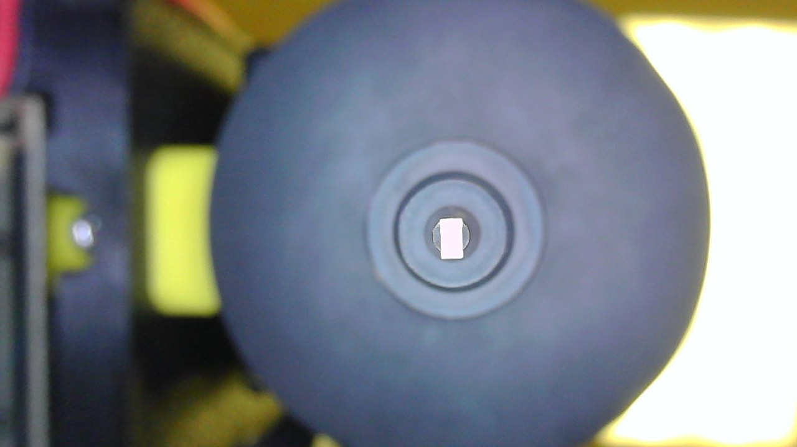
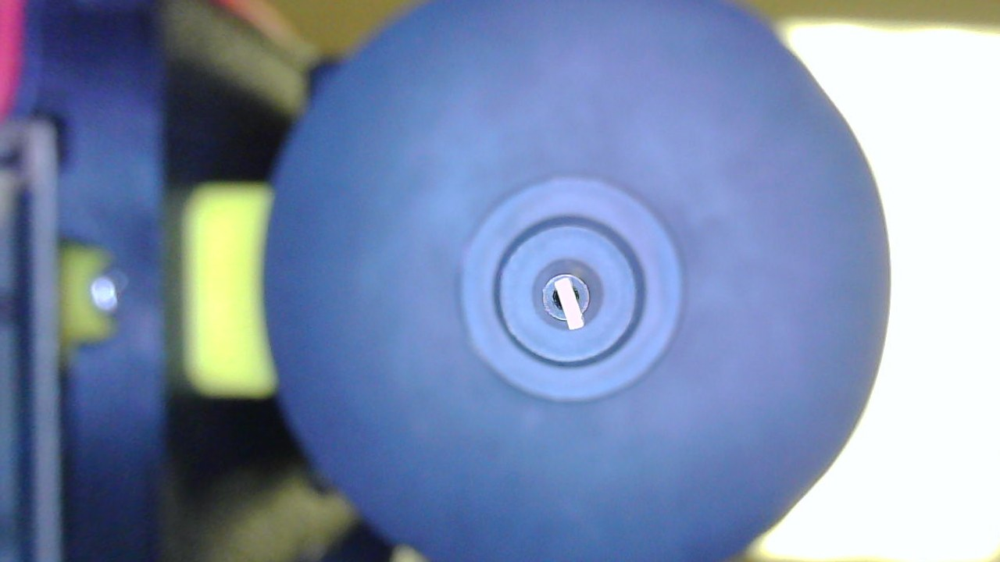
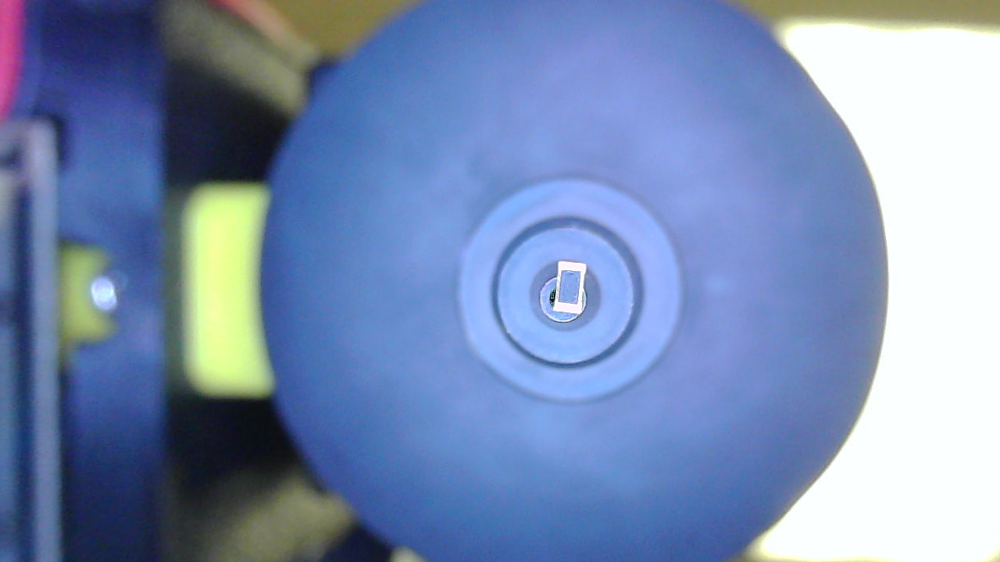
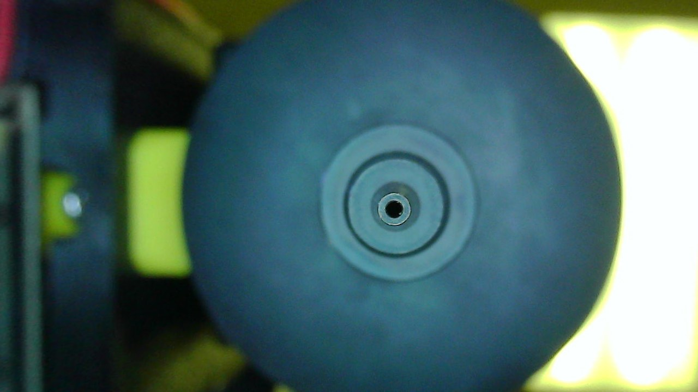
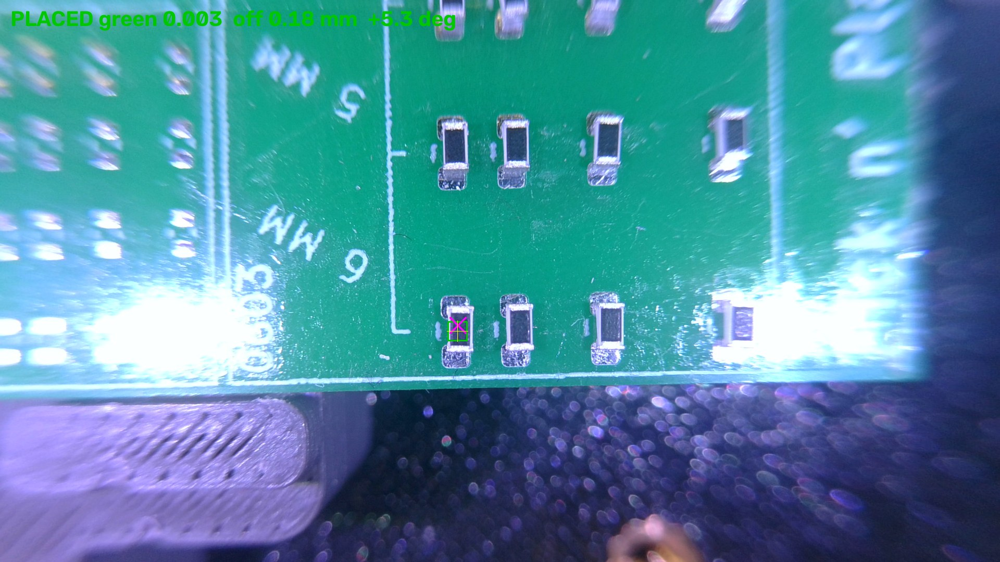
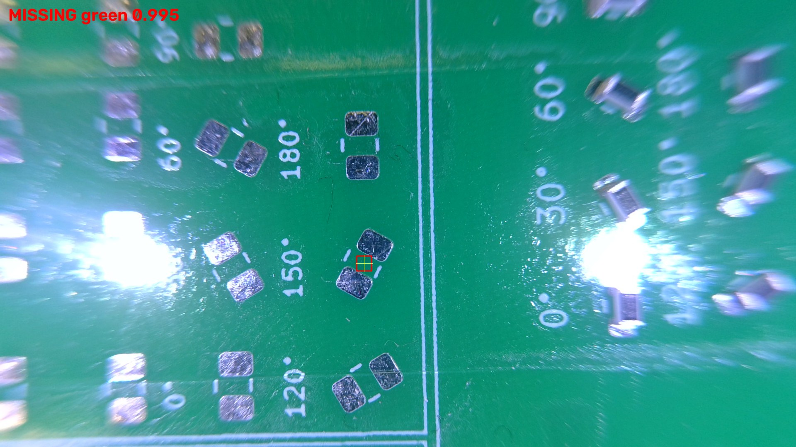
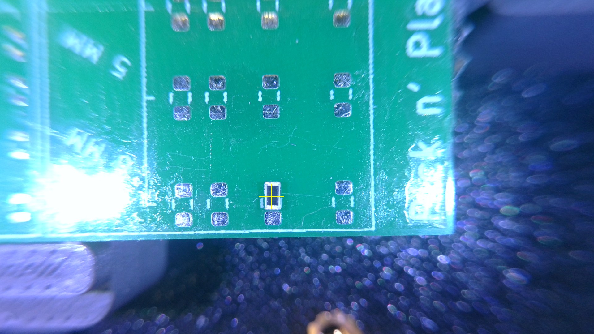
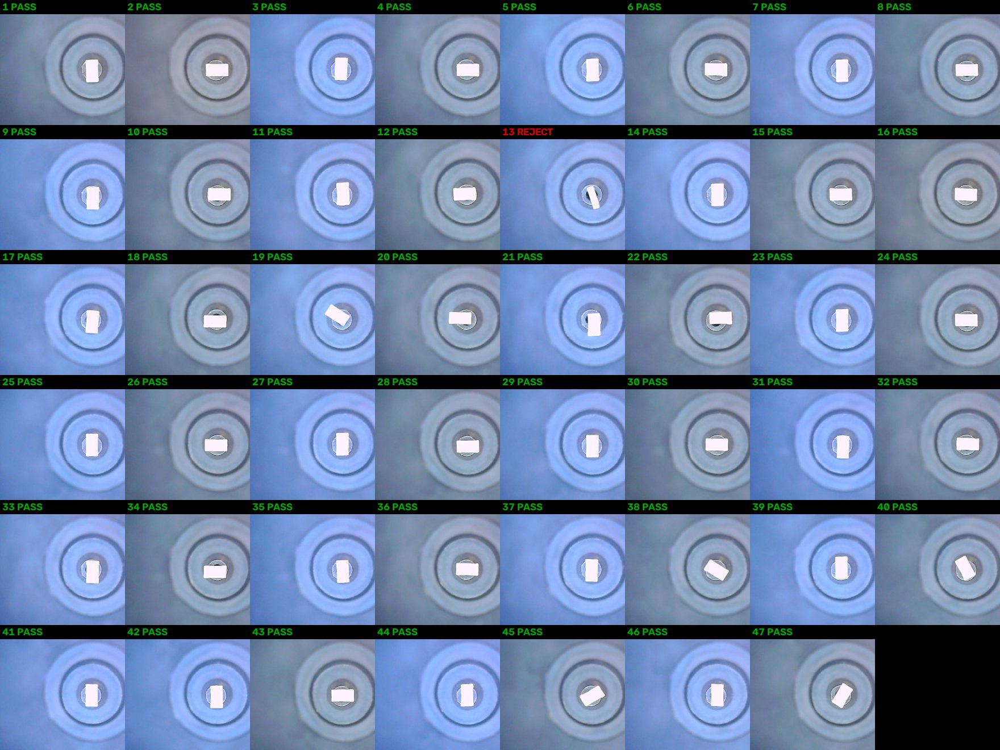
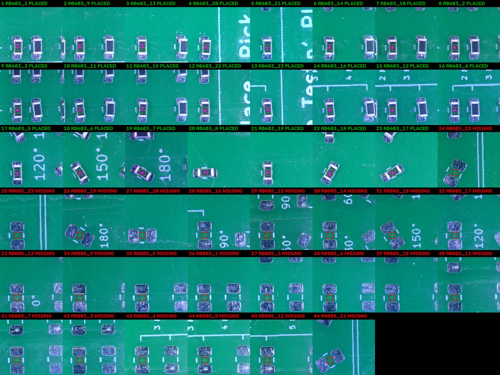

# Sample Images and Data

Real photos and report files from the acceptance runs. The originals are in
`Documentation/samples/` in the repository (see its README).

## Up camera (part on the nozzle)

| | |
|---|---|
|  | **PASS**: 0603 seen from below, size and angle measured |
|  | **REJECT**: picked on its side (wrong size) -> reject bin |
|  | **REJECT**: resistor upside down (dark top facing the camera) |
|  | **EMPTY**: bare tip, nothing picked -> feed and try again |

## Down camera (board)

| | |
|---|---|
|  | `check-board`: **PLACED**, offset measured |
|  | `check-board`: **MISSING** (bare green pads) |
|  | dry run: crosshair = target. Here the board had moved since alignment - re-align |

## Contact sheets

## Report files

`Documentation/samples/report/` holds `summary.txt`, `cycles.csv` and `placement_review.csv` from
these runs. What each column means: [After the Job](../operate/after-the-job.md#the-report).
