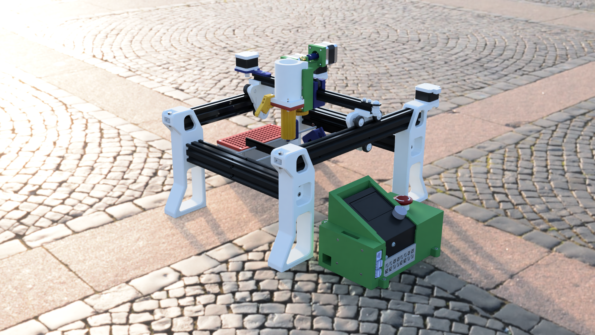

## 🛠️ Assembly Gallery

| Component Focus | Snapshot | Key Detail |
| :--- | :---: | :--- |
| **Tool Head** |  | Fully 3D-printable supporting 4-axes |
| **Clamping** |  | PCB securing, fully 3D printed clamping mechanism, fitting within T-slots |
| **Electrical Enclosure** |  | The brains; houses Pi 5 & OctoPro |
| **Organized Setup** |  | Real-life build |
| **Master Shot** |  | Render shot complete with every subassembly |
