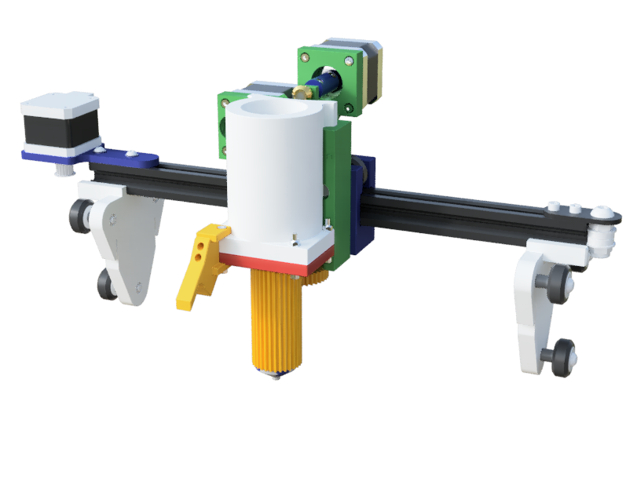
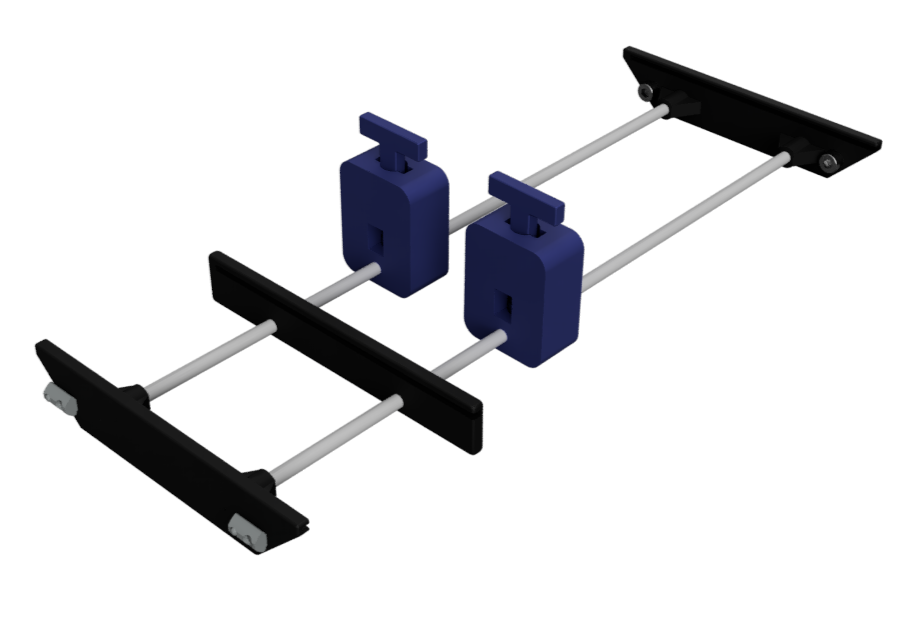
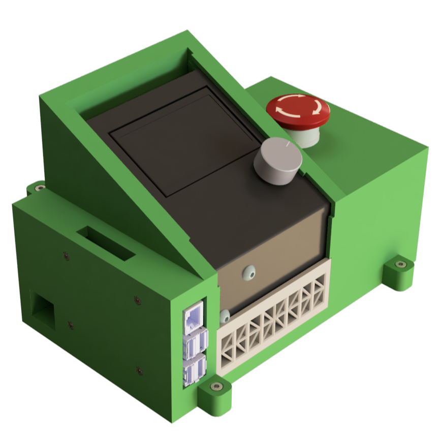
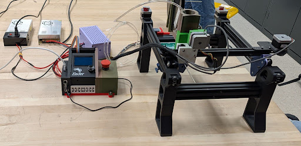

# Media

Photos, renders and videos of the OSHE Pick and Place. Licensed CC BY-SA 4.0.

## V3 (Fall 2026, current)

| What | File | Notes |
|---|---|---|
| **Placing 0603s, real speed** |  | `Documentation/docs/assets/media/job-realtime.gif` (14 s, two parts); also `job-realtime.mp4` (23 s) and `one-part-realtime.gif` (7 s) |
| Hero photo | *coming* | full machine, for the README and the docs home page |
| Render | *coming* | from `CAD/V3-Active/PnP_Full_Assembly_V3.step` |

Sample camera images and report files from the acceptance runs are in
[`Documentation/samples/`](../Documentation/samples).

## Sponsors

| Sponsor | File |
|---|---|
| Harbor Country Marine, New Buffalo, MI | `Sponsors/harbor-country-marine.png` |

## V2 (Spring 2026, legacy) Assembly Gallery

| Component Focus | Snapshot | Key Detail |
| :--- | :---: | :--- |
| **Tool Head** |  | Fully 3D-printable supporting 4-axes |
| **Clamping** |  | PCB securing, fully 3D printed clamping mechanism, fitting within T-slots |
| **Electrical Enclosure** |  | The brains; housed the V2 Pi 5 & Octopus Pro |
| **Organized Setup** |  | Real-life build |
| **Master Shot** |  | Render shot complete with every subassembly |
