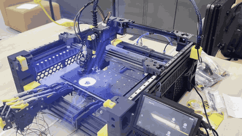

# OSHE Pick and Place (V3)

*V3 placing 0603 resistors at real speed: feed, pick, up-camera check, place.*

## 🎯 Summary

The **OSHE Pick and Place** is a low-cost, open-source machine that places surface-mount parts
onto printed circuit boards. It starts from the parts of a Creality Ender 3 3D printer and adds a
3D-printed **CoreXY** frame (inspired by the Voron 2.3), a LumenPnP-style vacuum toolhead with
Samsung CP40 nozzle tips, **two cameras**, servo tape feeders and its own software. It is built by
students of the **[Open Source Hardware Enterprise (oshe.io)](https://oshe.io)** at Michigan
Technological University, so that small labs and hobbyists can assemble boards without an
industrial machine.

**Project state: functional prototype (Fall 2026).** The machine runs complete jobs from its
touchscreen. The V3 bill of materials, wiring diagram, step-by-step build guide and some CAD are
still being added (see [What's still missing](#-whats-still-missing)).

### 🛠️ What V3 does (acceptance runs, 2026-11-18)

| | Result |
|---|---|
| **Speed** | ~**511 parts per hour** on average over four 23-part runs (best 527); target 500 |
| **Picks from tape** | **97.9 %** (92 of 94, 0603 resistors); target 95 % |
| **Placement accuracy** | mean error **0.075 - 0.094 mm** per board, worst 0.229 mm |
| **Vision** | every part checked on the nozzle by the up camera (size, angle, on its side, upside down) and corrected before placing; the down camera finds the board from its own pads (no fiducials needed) and checks placed parts; all 193 + 138 decisions judged correct by hand |
| **No laptop needed** | jobs load from an SD card / USB stick and run from the touchscreen, with Continue / Stop / **Emergency stop** on screen |
| **Design to board** | KiCad `.kicad_pcb` -> **pnpslice** (Windows app or Python) -> job file -> machine |

Full numbers, plots and the test procedure: `Documentation/docs/testing/`.

---

## 📂 Documentation

> [!IMPORTANT]
> The **V3 documentation site** is in [`Documentation/`](Documentation): build, software setup,
> calibration, running jobs, feeders, safety, troubleshooting and results. Read it on GitHub
> starting at [`Documentation/docs/index.md`](Documentation/docs/index.md), or run it locally
> (instructions in [`Documentation/README.md`](Documentation/README.md)). It is not published
> online yet.

| Start here | Link |
|---|---|
| How it works, specs | [Documentation/docs/overview](Documentation/docs/overview/index.md) |
| **Safety** (read first) | [Documentation/docs/overview/safety.md](Documentation/docs/overview/safety.md) |
| Building one | [Documentation/docs/build](Documentation/docs/build/index.md) |
| Installing the software | [Documentation/docs/software/install.md](Documentation/docs/software/install.md) |
| Running a job | [Documentation/docs/operate](Documentation/docs/operate/index.md) |
| Results | [Documentation/docs/testing/results.md](Documentation/docs/testing/results.md) |
| Older versions (V1/V2) | [History](Documentation/docs/project/history.md) and the [V2 manual (Google Doc)](https://docs.google.com/document/d/1zdPMhOE8R7Szz68Ky9EoDyxVyp7iftD7q8Uco1WKPY8/edit?usp=sharing) |

---

## 📋 Repository Structure

| Folder | Contents |
|---|---|
| [`CAD/`](CAD) | STEP / 3MF / DXF files: `V3-Active` (current), `V2-Legacy`, `V1-Legacy` |
| [`BOMs/`](BOMs) | bills of materials (V3 being written; V1/V2 in `Legacy/`) |
| [`Software/Klipper/`](Software/Klipper) | Klipper config (`printer.cfg`, macros, feeders, lights) and the touchscreen Job page |
| [`Software/pnpvision/`](Software/pnpvision) | the machine software on the Pi: calibration, board alignment, job runner, reports |
| [`Software/Slicer/`](Software/Slicer) | **pnpslice**: KiCad board -> job file (Windows app or Python) |
| [`Software/Legacy-Marlin/`](Software/Legacy-Marlin), [`Software/feeder_nano/`](Software/feeder_nano) | old firmware, not used by V3 |
| [`Documentation/`](Documentation) | the documentation site (`docs/`) and sample machine outputs (`samples/`) |
| [`Media/`](Media) | photos, renders, videos |
| [`Archive/`](Archive) | earlier tools; the camera-calibration tool in there is still used by V3 |

## 💻 Getting Started

1. Read **[Safety](Documentation/docs/overview/safety.md)** and **[How It Works](Documentation/docs/overview/index.md)**.
2. Build: print `CAD/V3-Active`, take apart an Ender 3, assemble ([Build](Documentation/docs/build/index.md)).
3. Install MainsailOS, Klipper and pnpvision on a Raspberry Pi 4 ([Install from Scratch](Documentation/docs/software/install.md)).
4. Calibrate the cameras once ([Calibration](Documentation/docs/calibration/index.md)).
5. Slice your KiCad board with **pnpslice** and run it ([Running Jobs](Documentation/docs/operate/index.md)).
   The Windows app `pnpslice.exe` is built with `Software/Slicer/build_exe.ps1` (it will also be
   attached to the repository's **Releases**); or run pnpslice from Python on any OS.

Questions, ideas and other OSHE projects: **[oshe.io](https://oshe.io)** and the
[OSHE GitHub](https://github.com/OSHE-Github).

## 🚧 What's still missing

- V3 toolhead, modified 0816 feeder, electrical mounting brackets and the complete assembly in `CAD/V3-Active`
- V3 bill of materials, wiring diagram and step-by-step build guide with photos
- A hardware emergency-stop switch (the machine has a software emergency stop on the touchscreen)

## ⚠️ Safety in one paragraph

The gantry moves at up to 400 mm/s: keep hands out while the touchscreen shows **JOB RUNNING**.
**EMERGENCY STOP** is on the touchscreen (Job page and Pick & Place menu) and in Mainsail; for a
hard stop switch off the power supply. The compressor and venturi exhaust are loud: **wear hearing
protection during long runs**. Details: [Safety](Documentation/docs/overview/safety.md).

## 👥 Team

**Current team (Fall 2026, V3):** Joey P and Matthew C (on the project since V1),
Jake G and Isaac A (joined for V3).

**Past contributors (V1 Fall 2025, V2 Spring 2026):** Donn B, Raymond N, Toby C, Loyal S.

## 🤝 Project Sponsors

**Harbor Country Marine**, New Buffalo, MI: thank you for supporting the project.

---

## ⚖️ License

Every file in this repository is covered by one of the licenses below.

### LICENSE-SOFTWARE (GNU GPL v3)
All source code, firmware, scripts, and configuration files anywhere in this repository, including `/Software` and any code in `/Archive`, are licensed under the [GNU General Public License v3.0](LICENSE-SOFTWARE).

The firmware in `/Software/Legacy-Marlin` is based on [Marlin](https://github.com/MarlinFirmware/Marlin) (© Marlin Firmware contributors, GPL v3). Our modifications to it are also released under GPL v3.

### LICENSE-HARDWARE (CERN-OHL-S v2)
All hardware design files and documentation anywhere in this repository, including `/CAD`, `/BOMs`, hardware in `/Archive`, and this README, are licensed under the [CERN Open Hardware Licence Version 2 – Strongly Reciprocal](LICENSE-HARDWARE).

### Media (CC BY-SA 4.0)
Photos, renders, and other images, including everything in `/Media`, are licensed under [Creative Commons Attribution-ShareAlike 4.0](https://creativecommons.org/licenses/by-sa/4.0/).

Any file not clearly covered above falls under CERN-OHL-S v2.

---
*Developed under the Michigan Technological University Open Source Hardware Enterprise ([oshe.io](https://oshe.io)).*

*ABET Accrediting: [Checklist](https://docs.google.com/document/d/1hHnjDPqjZ3jRmd8Yd_ip3oN7XcyjQFGSi8Tkr0fagdQ/edit?usp=sharing)*
